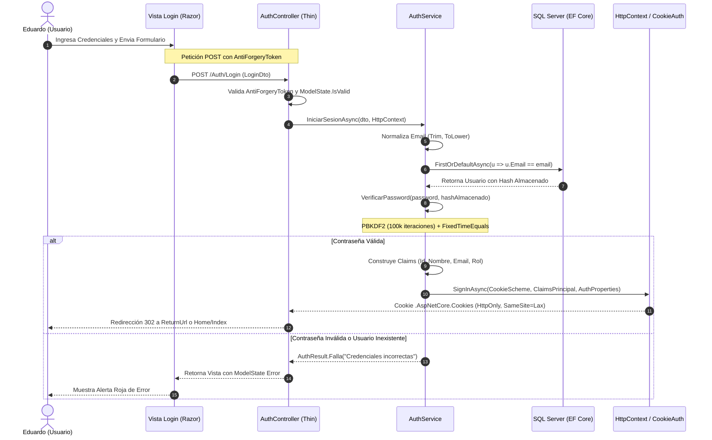
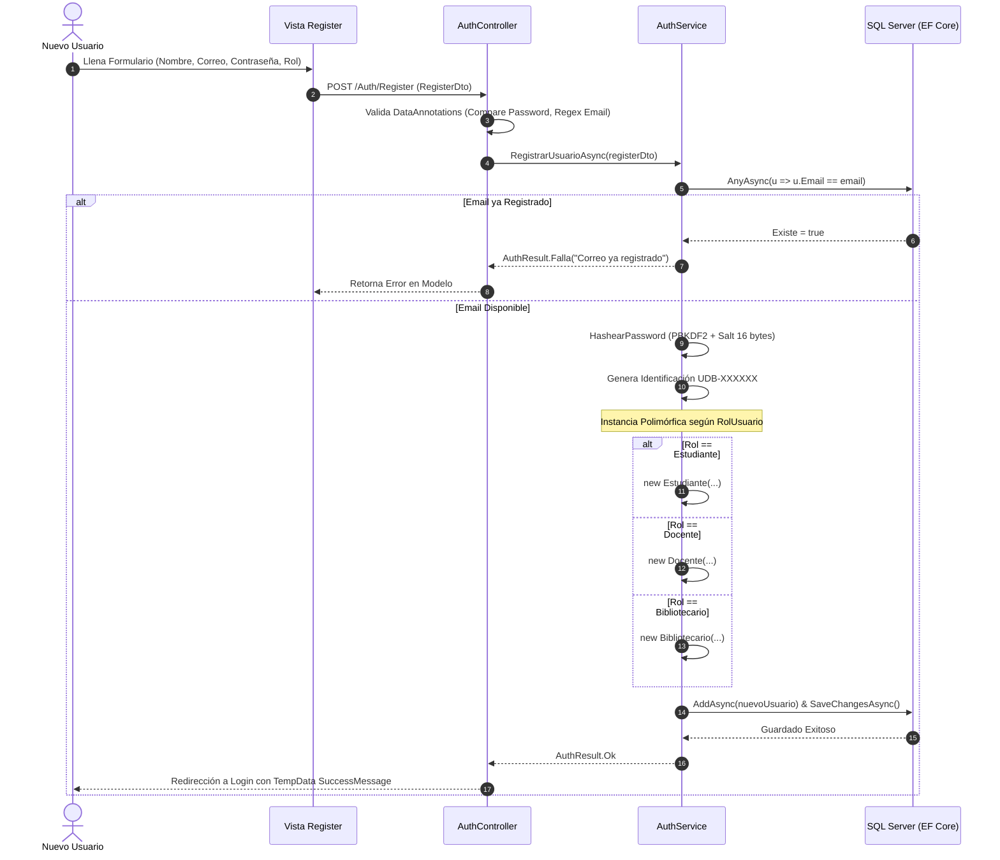
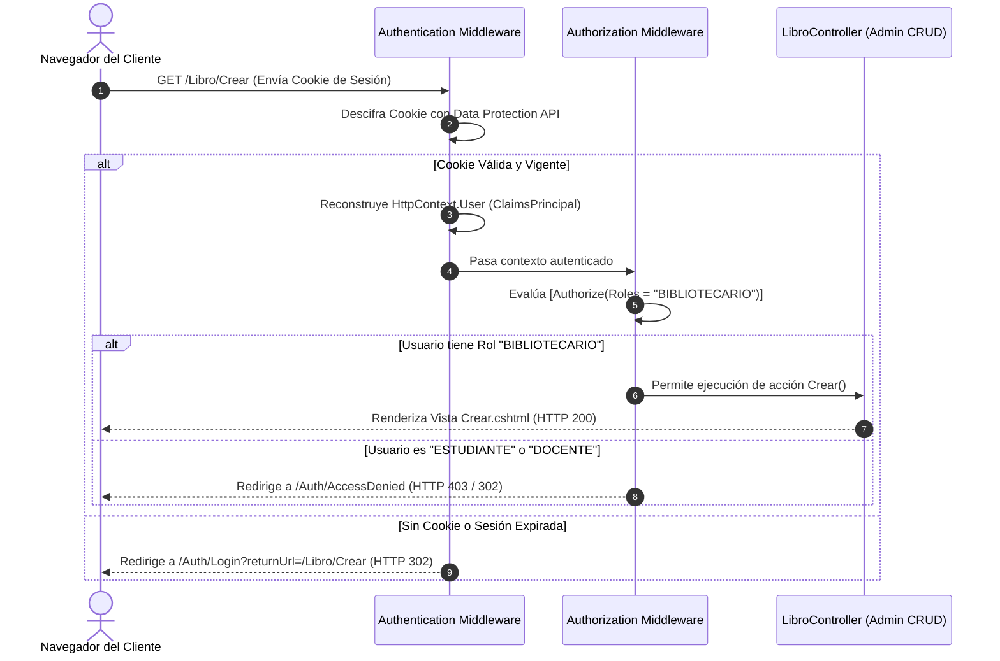

# 📚 Manual de Estudio y Guía de Defensa Técnica
## Seguridad, Criptografía, Autenticación y Ciclo de Vida de Validaciones

> **Proyecto:** Sistema de Gestión de Biblioteca Universitaria (`BibliotecaApp_CF1_DPS`)  
> **Catedrático / Jurado Evaluador:** Defensa de Proyecto de Cátedra  
> **Desarrollador / Ponente:** Eduardo  
> **Stack:** ASP.NET Core 9.0 (.NET 9) MVC + Web API Coexistente, Entity Framework Core, SQL Server (LocalDB)  
> **Patrón Arquitectónico:** Thin Controllers + Capa de Servicios de Dominio/Aplicación + DTOs Segregados + RBAC (Role-Based Access Control)

---

## Índice General

1. [Visión General de la Arquitectura de Seguridad](#1-visión-general-de-la-arquitectura-de-seguridad)
2. [Gestión de Sesiones y el "Token" Criptográfico (Cookie Auth vs. JWT)](#2-gestión-de-sesiones-y-el-token-criptográfico-cookie-auth-vs-jwt)
3. [Criptografía de Contraseñas a Bajo Nivel (PBKDF2 + Salt + HMAC-SHA256)](#3-criptografía-de-contraseñas-a-bajo-nivel-pbkdf2--salt--hmac-sha256)
4. [Ciclo de Vida del Flujo de Registro (Register)](#4-ciclo-de-vida-del-flujo-de-registro-register)
5. [Ciclo de Vida del Flujo de Inicio de Sesión (Login)](#5-ciclo-de-vida-del-flujo-de-inicio-de-sesión-login)
6. [El Pipeline Defensivo: Ciclo de Vida de las Validaciones](#6-el-pipeline-defensivo-ciclo-de-vida-de-las-validaciones)
7. [Control de Acceso Basado en Roles (RBAC) y Seguridad en Préstamos](#7-control-de-acceso-basado-en-roles-rbac-y-seguridad-en-préstamos)
8. [Diagramas de Arquitectura y Secuencia (Mermaid)](#8-diagramas-de-arquitectura-y-secuencia-mermaid)
9. [Banco de Preguntas Clave y Respuestas de Nivel Senior para la Defensa](#9-banco-de-preguntas-clave-y-respuestas-de-nivel-senior-para-la-defensa)

---

## 1. Visión General de la Arquitectura de Seguridad

La arquitectura de seguridad de **BibliotecaApp** está construida siguiendo los principios de **Defensa en Profundidad (Defense-in-Depth)** y el principio de **Mínimo Privilegio (Least Privilege)**. 

El sistema separa estrictamente las responsabilidades:
- **Controladores Delgados (Thin Controllers):** [AuthController.cs](file:///c:/Users/eduardo/OneDrive/Documentos/GitHub/BibliotecaApp_CF1_DPS/Controllers/AuthController.cs) y [UsuariosApiController.cs](file:///c:/Users/eduardo/OneDrive/Documentos/GitHub/BibliotecaApp_CF1_DPS/Controllers/UsuariosApiController.cs) únicamente actúan como guardianes de entrada HTTP, validan el modelo entrante y delegan el 100% de la lógica a la capa de servicios.
- **Capa de Abstracción y Contratos:** [IAuthService.cs](file:///c:/Users/eduardo/OneDrive/Documentos/GitHub/BibliotecaApp_CF1_DPS/Interfaces/IAuthService.cs) define el contrato puro sin acoplarse a detalles de infraestructura.
- **Servicio Criptográfico Central:** [AuthService.cs](file:///c:/Users/eduardo/OneDrive/Documentos/GitHub/BibliotecaApp_CF1_DPS/Services/AuthService.cs) encapsula las funciones matemáticas de derivación de claves, verificación a tiempo constante, resolución de claims y generación de la identidad segura del usuario.

```
[ Navegador Web / Cliente API ]
               │
               ▼
   [ Middleware Anti-CSRF ] ─── Valida Token Anti-Falsificación (Formularios POST)
               │
               ▼
   [ Model Binder + DTOs ] ──── Valida Data Annotations (Formato, Requeridos, Longitudes)
               │
               ▼
   [ Thin Controller ] ──────── Valida ModelState.IsValid (Fail-Fast temprano)
               │
               ▼
   [ IAuthService ] ─────────── Reglas de Negocio, Criptografía PBKDF2 y EF Core
               │
               ▼
   [ Cookie Authentication ] ── Genera Ticket de Sesión Cifrado con Data Protection API
```

---

## 2. Gestión de Sesiones y el "Token" Criptográfico (Cookie Auth vs. JWT)

### ¿Cómo funciona el "Token" en esta aplicación?
Cuando el jurado pregunte sobre **"el token"** en este proyecto, la respuesta técnica precisa es:

> *"En nuestra aplicación web basada en ASP.NET Core MVC utilizamos **Cookie Authentication segura mediante tickets cifrados**. En este esquema, el 'token' de sesión no es un JWT expuesto en el navegador, sino un **AuthenticationTicket criptográficamente cifrado y firmado** por el Data Protection API de ASP.NET Core, transportado en una cookie con directivas `HttpOnly` y `SameSite`."*

### Configuración en el Pipeline ([Program.cs](file:///c:/Users/eduardo/OneDrive/Documentos/GitHub/BibliotecaApp_CF1_DPS/Program.cs#L30-L41))

En [Program.cs:L30-L41](file:///c:/Users/eduardo/OneDrive/Documentos/GitHub/BibliotecaApp_CF1_DPS/Program.cs#L30-L41) se inyecta y configura el esquema:

```csharp
builder.Services.AddAuthentication(CookieAuthenticationDefaults.AuthenticationScheme)
    .AddCookie(options =>
    {
        options.LoginPath = "/Auth/Login";               // Redirección si usuario no autenticado intenta entrar
        options.LogoutPath = "/Auth/Logout";             // Ruta para destruir el ticket de sesión
        options.AccessDeniedPath = "/Auth/AccessDenied"; // Redirección si el rol no tiene permisos suficientes
        options.ExpireTimeSpan = TimeSpan.FromHours(8);  // Vigencia máxima de la sesión (8 horas)
        options.SlidingExpiration = true;                // Renueva la vigencia si el usuario está activo
        options.Cookie.HttpOnly = true;                  // PROHÍBE que JavaScript acceda a la cookie (Anti-XSS)
        options.Cookie.SameSite = SameSiteMode.Lax;      // Mitiga ataques de falsificación entre sitios (Anti-CSRF)
    });
```

### Tabla Comparativa: Cookie Cifrada vs. JWT en LocalStorage (Para Defender ante el Jurado)

| Criterio | Cookie HttpOnly (Implementada en el Proyecto) | JWT en `localStorage` (Práctica Débil en MVC) |
| :--- | :--- | :--- |
| **Protección contra XSS** | **Inmune:** JavaScript no puede leer la cookie (`document.cookie` no tiene acceso). | **Vulnerable:** Cualquier script inyectado puede robar el JWT de inmediato. |
| **Manejo de Expiración** | **Nativo y Seguro:** Administrado en el servidor con `SlidingExpiration`. | **Complejo:** Requiere lógica de Refresh Tokens manual en cliente. |
| **Falsificación CSRF** | Mitigado con `SameSite = Lax` y `@Html.AntiForgeryToken()`. | No sufre CSRF, pero es vulnerable a XSS que es más severo. |
| **Idoneidad de Arquitectura** | **Estándar de la industria** para aplicaciones Server-Side Rendered (MVC). | Óptimo para SPAs desacopladas (React/Angular) o APIs móviles. |

---

## 3. Criptografía de Contraseñas a Bajo Nivel (PBKDF2 + Salt + HMAC-SHA256)

El almacenamiento de credenciales se encuentra implementado en [AuthService.cs](file:///c:/Users/eduardo/OneDrive/Documentos/GitHub/BibliotecaApp_CF1_DPS/Services/AuthService.cs#L24-L26) y [AuthService.cs:L128-L171](file:///c:/Users/eduardo/OneDrive/Documentos/GitHub/BibliotecaApp_CF1_DPS/Services/AuthService.cs#L128-L171).

### Parámetros Criptográficos ([AuthService.cs](file:///c:/Users/eduardo/OneDrive/Documentos/GitHub/BibliotecaApp_CF1_DPS/Services/AuthService.cs#L24-L26))
```csharp
private const int SaltSize = 16;        // 128 bits de sal única por usuario
private const int KeySize = 32;         // 256 bits de clave derivada final
private const int Iterations = 100_000; // 100,000 rondas de cómputo HMAC-SHA256
```

### 1. ¿Qué es PBKDF2 y por qué no usar SHA-256 directo?
- **SHA-256 directo** es una función hash de propósito general extremadamente rápida (un atacante con GPUs modernas puede computar miles de millones de hashes por segundo, facilitando ataques de fuerza bruta y diccionarios).
- **PBKDF2 (Password-Based Key Derivation Function 2 - RFC 2898 / NIST SP 800-132)** es un algoritmo de *Key Stretching* (estiramiento de clave). Aplica una función pseudoaleatoria (HMAC-SHA256) **100,000 veces consecutivas**, haciendo computacionalmente inviable un ataque de fuerza bruta masivo.

### 2. Generación del Salt y Hashing ([AuthService.cs:L128-L142](file:///c:/Users/eduardo/OneDrive/Documentos/GitHub/BibliotecaApp_CF1_DPS/Services/AuthService.cs#L128-L142))
```csharp
public string HashearPassword(string password)
{
    if (string.IsNullOrWhiteSpace(password))
        throw new ArgumentException("La contraseña no puede estar vacía.", nameof(password));

    // Generador criptográficamente seguro del Sistema Operativo (CSPRNG)
    byte[] salt = RandomNumberGenerator.GetBytes(SaltSize);

    // Derivación de clave PBKDF2 con HMAC-SHA256
    byte[] hash = Rfc2898DeriveBytes.Pbkdf2(
        password: Encoding.UTF8.GetBytes(password),
        salt: salt,
        iterations: Iterations,
        hashAlgorithm: HashAlgorithmName.SHA256,
        outputLength: KeySize);

    // Almacenamiento empaquetado: Salt en Base64 + Separador ':' + Hash en Base64
    return $"{Convert.ToBase64String(salt)}:{Convert.ToBase64String(hash)}";
}
```
* **¿Por qué el Salt es indispensable?:** Garantiza que dos usuarios con la misma contraseña (ej. `"Admin1234!"`) tengan hashes completamente diferentes en la base de datos, neutralizando por completo el uso de **Tablas Rainbow (Rainbow Tables)** precomputadas.

### 3. Verificación Segura y Prevención de Timing Attacks ([AuthService.cs:L144-L171](file:///c:/Users/eduardo/OneDrive/Documentos/GitHub/BibliotecaApp_CF1_DPS/Services/AuthService.cs#L144-L171))
```csharp
public bool VerificarPassword(string password, string hashAlmacenado)
{
    // ... extracción de salt y hashEsperado en Base64 ...
    byte[] hashActual = Rfc2898DeriveBytes.Pbkdf2(
        password: Encoding.UTF8.GetBytes(password),
        salt: salt,
        iterations: Iterations,
        hashAlgorithm: HashAlgorithmName.SHA256,
        outputLength: KeySize);

    // COMPARACIÓN A TIEMPO CONSTANTE:
    return CryptographicOperations.FixedTimeEquals(hashEsperado, hashActual);
}
```

#### 🛡️ Concepto Clave de Defensa: ¿Qué es un Timing Attack?
Si usáramos una comparación estándar como `hashEsperado == hashActual` o `string.Equals`, el procesador compara byte a byte y **se detiene en el primer byte diferente** (Early Exit). Un atacante con medición de microsegundos en red puede inferir byte a byte el hash correcto analizando el tiempo de respuesta.  
`CryptographicOperations.FixedTimeEquals` itera **siempre todos los bytes** sin importar si el primero falla, garantizando que el tiempo de ejecución sea idéntico y evitando la fuga de información por canal lateral (Side-Channel Timing Attack).

---

## 4. Ciclo de Vida del Flujo de Registro (Register)

### Paso 1: Entrada y Validación en el DTO ([RegisterDto.cs](file:///c:/Users/eduardo/OneDrive/Documentos/GitHub/BibliotecaApp_CF1_DPS/DTOs/Auth/RegisterDto.cs#L9-L36))
El usuario envía el formulario con:
- `NombreCompleto`: Requerido, entre 3 y 100 caracteres.
- `Email`: Requerido, validado con formato de correo institucional.
- `Password`: Requerido, mínimo 8 caracteres.
- `ConfirmarPassword`: Validado mediante `[Compare(nameof(Password))]` para asegurar coincidencia en el cliente y servidor.
- `Rol`: Enum tipado [RolUsuario.cs](file:///c:/Users/eduardo/OneDrive/Documentos/GitHub/BibliotecaApp_CF1_DPS/Enums/RolUsuario.cs) (`Estudiante`, `Docente`, `Bibliotecario`).

### Paso 2: Recepción en Controlador ([AuthController.cs:L77-L97](file:///c:/Users/eduardo/OneDrive/Documentos/GitHub/BibliotecaApp_CF1_DPS/Controllers/AuthController.cs#L77-L97))
1. Se valida el token anti-falsificación: `[ValidateAntiForgeryToken]`.
2. Se evalúa `ModelState.IsValid`. Si el cliente manipuló datos, se corta la ejecución de inmediato y se retorna la vista con los mensajes de error.
3. Se invoca a `_authService.RegistrarUsuarioAsync(model)`.

### Paso 3: Lógica de Dominio en Capa de Servicio ([AuthService.cs:L76-L120](file:///c:/Users/eduardo/OneDrive/Documentos/GitHub/BibliotecaApp_CF1_DPS/Services/AuthService.cs#L76-L120))
1. **Normalización del Correo:** `registerDto.Email.Trim().ToLowerInvariant()` para evitar duplicados por mayúsculas/minúsculas.
2. **Validación de Unicidad:** `await _context.Usuarios.AnyAsync(u => u.Email == emailNormalizado)`. Si existe, retorna `AuthResult.Falla(...)`.
3. **Criptografía:** Se genera el hash con salt aleatorio invocando `HashearPassword(registerDto.Password)`.
4. **Instanciación Polimórfica:**
   ```csharp
   Usuario nuevoUsuario = registerDto.Rol switch
   {
       RolUsuario.Estudiante => new Estudiante(nombre, idAuto, email, passwordHash),
       RolUsuario.Docente => new Docente(nombre, idAuto, email, passwordHash),
       RolUsuario.Bibliotecario => new Bibliotecario(nombre, idAuto, email, passwordHash),
       _ => throw new InvalidOperationException(...)
   };
   ```
5. **Persistencia Transaccional:** `await _context.Usuarios.AddAsync(nuevoUsuario); await _context.SaveChangesAsync();`.

---

## 5. Ciclo de Vida del Flujo de Inicio de Sesión (Login)

### Paso 1: Formulario Seguro y Protección CSRF ([Login.cshtml](file:///c:/Users/eduardo/OneDrive/Documentos/GitHub/BibliotecaApp_CF1_DPS/Views/Auth/Login.cshtml#L25-L26))
El formulario incluye `@Html.AntiForgeryToken()`, que genera dos tokens sincronizados: uno en una cookie cifrada y otro como campo oculto en el formulario HTML.

### Paso 2: Controlador Delgado ([AuthController.cs:L35-L63](file:///c:/Users/eduardo/OneDrive/Documentos/GitHub/BibliotecaApp_CF1_DPS/Controllers/AuthController.cs#L35-L63))
```csharp
[HttpPost]
[AllowAnonymous]
[ValidateAntiForgeryToken]
public async Task<IActionResult> Login(LoginDto model, string? returnUrl = null)
{
    if (!ModelState.IsValid) return View(model);

    var resultado = await _authService.IniciarSesionAsync(model, HttpContext);

    if (!resultado.Exitoso)
    {
        ModelState.AddModelError(string.Empty, resultado.Mensaje);
        return View(model);
    }

    // PREVENCIÓN DE VULNERABILIDAD OPEN REDIRECT
    if (!string.IsNullOrEmpty(returnUrl) && Url.IsLocalUrl(returnUrl))
    {
        return Redirect(returnUrl);
    }

    return RedirectToAction("Index", "Home");
}
```

> **🛡️ Punto para la Defensa (Open Redirect Attack):**  
> Si un atacante envía un enlace con `returnUrl=http://sitio-malicioso.com`, la función `Url.IsLocalUrl(returnUrl)` en la línea 57 detecta que no es una URL relativa local (`/Libro/Detalle/...`) y rechaza la redirección externa, redirigiendo a `Home/Index`.

### Paso 3: Servicio de Autenticación ([AuthService.cs:L34-L74](file:///c:/Users/eduardo/OneDrive/Documentos/GitHub/BibliotecaApp_CF1_DPS/Services/AuthService.cs#L34-L74))
1. **Búsqueda en Base de Datos:** Busca el usuario por email normalizado.
2. **Verificación de Contraseña:** Ejecuta `VerificarPassword(...)` usando el salt almacenado en la BD.
3. **Mensaje de Error Genérico (User Enumeration Protection):** Si el usuario no existe o la contraseña es inválida, se retorna el mismo mensaje: `"Correo electrónico o contraseña incorrectos."`. Esto evita que un atacante descubra qué correos están registrados.
4. **Construcción de Claims:**
   ```csharp
   var claims = new List<Claim>
   {
       new(ClaimTypes.NameIdentifier, usuario.Id.ToString()),
       new(ClaimTypes.Name, usuario.Nombre),
       new(ClaimTypes.Email, usuario.Email),
       new(ClaimTypes.Role, usuario.ObtenerRol()) // "BIBLIOTECARIO", "ESTUDIANTE" o "DOCENTE"
   };
   ```
5. **Emisión de la Cookie de Sesión:**
   ```csharp
   await httpContext.SignInAsync(
       CookieAuthenticationDefaults.AuthenticationScheme,
       new ClaimsPrincipal(claimsIdentity),
       authProperties);
   ```

---

## 6. El Pipeline Defensivo: Ciclo de Vida de las Validaciones

La validación en `BibliotecaApp` no ocurre en un solo lugar, sino a través de **5 Barreras Defensivas Consecutivas**:

```
[ Solicitud HTTP Entrante ]
            │
 ┌──────────┴────────────────────────────────────────────────┐
 │ 1. BARRERA DE ENLACE Y FORMATO (Data Annotations)         │
 │    - Campos [Required], [EmailAddress], [StringLength]     │
 │    - Rechazo temprano si el formato JSON o Form es inválido│
 └──────────┬────────────────────────────────────────────────┘
            ▼
 ┌──────────┴────────────────────────────────────────────────┐
 │ 2. BARRERA ANTI-FALSIFICACIÓN (Security Tokens)           │
 │    - Verificación del AntiForgeryToken                    │
 │    - Protege contra ataques CSRF de sitios de terceros    │
 └──────────┬────────────────────────────────────────────────┘
            ▼
 ┌──────────┴────────────────────────────────────────────────┐
 │ 3. BARRERA DEL CONTROLADOR (ModelState Guard)             │
 │    - Evaluación if (!ModelState.IsValid)                  │
 │    - Impide que datos corruptos alcancen los servicios    │
 └──────────┬────────────────────────────────────────────────┘
            ▼
 ┌──────────┴────────────────────────────────────────────────┐
 │ 4. BARRERA DE SERVICIO (Reglas de Negocio)                │
 │    - Unicidad de correo electrónico                       │
 │    - Verificación criptográfica de contraseña             │
 │    - Existencia de ejemplares físicos disponibles en stock│
 └──────────┬────────────────────────────────────────────────┘
            ▼
 ┌──────────┴────────────────────────────────────────────────┐
 │ 5. BARRERA DE DOMINIO (Inmutabilidad y Encapsulamiento)   │
 │    - Constructores protegidos con validación obligatoria  │
 │    - Throw ArgumentException si hay invariantes violadas  │
 └───────────────────────────────────────────────────────────┘
```

---

## 7. Control de Acceso Basado en Roles (RBAC) y Seguridad en Préstamos

### 1. Autorización Declarativa en Controladores
- **Acceso a Vistas Protegidas:** [LibroController.cs:L14](file:///c:/Users/eduardo/OneDrive/Documentos/GitHub/BibliotecaApp_CF1_DPS/Controllers/LibroController.cs#L14) decora la clase con `[Authorize]`, exigiendo que cualquier visitante esté autenticado.
- **Acceso Administrativo Exclusivo:** [LibroController.cs:L48, L55](file:///c:/Users/eduardo/OneDrive/Documentos/GitHub/BibliotecaApp_CF1_DPS/Controllers/LibroController.cs#L48) decora las acciones de `Crear`, `Editar` y `Eliminar` con:
  ```csharp
  [Authorize(Roles = "BIBLIOTECARIO,Bibliotecario")]
  ```
  Si un usuario con rol `ESTUDIANTE` intenta invocar `POST /Libro/Eliminar/{id}`, el middleware de ASP.NET Core intercepta la petición y lo redirige automáticamente a `/Auth/AccessDenied` ([AuthController.cs:L109](file:///c:/Users/eduardo/OneDrive/Documentos/GitHub/BibliotecaApp_CF1_DPS/Controllers/AuthController.cs#L109)).

### 2. Extracción Segura de la Identidad en Préstamos ([PrestamoController.cs:L26, L40](file:///c:/Users/eduardo/OneDrive/Documentos/GitHub/BibliotecaApp_CF1_DPS/Controllers/PrestamoController.cs#L26))
En la gestión de préstamos, el controlador **nunca** confía en parámetros enviados por el formulario para identificar al usuario que solicita el libro:
```csharp
// EXTRACCIÓN DIRECTA DESDE EL TICKET CRIPTOGRÁFICO DE SESIÓN:
var email = User.FindFirst(ClaimTypes.Email)?.Value ?? User.Identity?.Name;
```
* **Impacto en Seguridad:** Esto previene el ataque de **Suplantación de Identidad / Parameter Tampering**. Un estudiante no puede solicitar un préstamo a nombre de otro estudiante modificando el ID en la petición HTTP, ya que el ID proviene exclusivamente de la cookie firmada por el servidor.

---

## 8. Diagramas de Arquitectura y Secuencia (Mermaid)

### Diagrama 1: Flujo de Inicio de Sesión (Login) y Emisión de Cookie



---

### Diagrama 2: Flujo de Registro de Usuario y Polimorfismo



---

### Diagrama 3: Pipeline de Autorización en Petición a Ruta Protegida



---

## 9. Banco de Preguntas Clave y Respuestas de Nivel Senior para la Defensa

Prepárate con estas respuestas técnicas directas cuando el jurado te interrogue:

### P1: ¿Por qué eligieron Autenticación por Cookies en lugar de JWT (JSON Web Tokens) en esta aplicación?
> **Respuesta:**  
> *"Nuestra solución es una aplicación web renderizada en el servidor mediante **ASP.NET Core MVC**. Para esta arquitectura, las **Cookies de autenticación con directiva `HttpOnly` y `SameSite` representan el estándar de oro en seguridad** de OWASP. Un JWT en el cliente suele guardarse en `localStorage` o `sessionStorage`, lo que lo expone directamente al robo de credenciales mediante ataques XSS (Cross-Site Scripting). La cookie segura es inaccesible para scripts maliciosos de JavaScript y se envía automáticamente en cada petición con protección anti-CSRF."*

### P2: ¿Qué algoritmo de cifrado o hashing utilizaron para las contraseñas y por qué?
> **Respuesta:**  
> *"Utilizamos **PBKDF2 (Password-Based Key Derivation Function 2) con HMAC-SHA256**, regulado bajo el estándar NIST SP 800-132. No usamos SHA-256 ni MD5 directamente porque son funciones rápidas vulnerables a ataques masivos por fuerza bruta con GPUs. PBKDF2 aplica un factor de trabajo deliberado de **100,000 iteraciones** y un **Salt criptográfico de 16 bytes** por usuario generado con `RandomNumberGenerator`. Esto neutraliza por completo los ataques de tablas Rainbow y fuerza bruta."*

### P3: ¿Para qué sirve el Salt y cómo se almacena en la base de datos?
> **Respuesta:**  
> *"El Salt es una secuencia aleatoria de 128 bits única para cada usuario que se combina con la contraseña antes de derivar la clave. Asegura que dos usuarios con contraseñas idénticas tengan valores hash completamente distintos. En nuestro modelo ([AuthService.cs:L141](file:///c:/Users/eduardo/OneDrive/Documentos/GitHub/BibliotecaApp_CF1_DPS/Services/AuthService.cs#L141)), el salt no se guarda en una columna separada; se almacena empaquetado en formato `{Base64(Salt)}:{Base64(Hash)}`, permitiendo que el verificador extraiga el salt exacto para recrear el hash en el login."*

### P4: ¿Cómo previenen los ataques de temporización (Timing Attacks) al validar la contraseña?
> **Respuesta:**  
> *"En [AuthService.cs:L165](file:///c:/Users/eduardo/OneDrive/Documentos/GitHub/BibliotecaApp_CF1_DPS/Services/AuthService.cs#L165) utilizamos `CryptographicOperations.FixedTimeEquals(hashEsperado, hashActual)`. Una comparación convencional de strings (`==`) finaliza tan pronto como encuentra el primer carácter diferente, lo que permite a un atacante medir diferencias en nanosegundos para inferir el hash. `FixedTimeEquals` compara siempre la totalidad de los bytes en un tiempo constante, cerrando esa vulnerabilidad por canal lateral."*

### P5: ¿Qué función cumple el atributo `[ValidateAntiForgeryToken]` en los formularios?
> **Respuesta:**  
> *"Previene ataques de tipo **CSRF (Cross-Site Request Forgery)**. Garantiza que la solicitud POST provenga legítimamente de una vista renderizada por nuestro propio servidor y no desde un sitio malicioso externo que intente inducir al navegador de la víctima autenticada a ejecutar acciones no autorizadas."*

### P6: ¿Cómo evitan que un atacante descubra qué correos están registrados (User Enumeration)?
> **Respuesta:**  
> *"Tanto si el correo no existe en la base de datos como si la contraseña no coincide, [AuthService.cs:L46](file:///c:/Users/eduardo/OneDrive/Documentos/GitHub/BibliotecaApp_CF1_DPS/Services/AuthService.cs#L46) retorna exactamente el mismo mensaje unificado: `'Correo electrónico o contraseña incorrectos'`. No revelamos si el fallo fue por usuario o por clave, impidiendo la enumeración de cuentas."*

### P7: ¿Qué es la vulnerabilidad de Open Redirect y cómo está mitigada?
> **Respuesta:**  
> *"Ocurre cuando un atacante manipula el parámetro `returnUrl` en la URL de login para que, tras iniciar sesión, el usuario sea redirigido a un sitio malicioso de phishing. En [AuthController.cs:L57](file:///c:/Users/eduardo/OneDrive/Documentos/GitHub/BibliotecaApp_CF1_DPS/Controllers/AuthController.cs#L57) validamos que `Url.IsLocalUrl(returnUrl)` sea verdadero antes de redirigir, garantizando que el destino siempre sea una ruta interna de nuestro dominio."*

### P8: ¿Cómo se manejan los roles y permisos en el sistema?
> **Respuesta:**  
> *"Manejamos un esquema **RBAC (Role-Based Access Control)** polimórfico. Las entidades `Estudiante`, `Docente` y `Bibliotecario` heredan de `Usuario` y sobreescriben `ObtenerRol()`. Al autenticarse, el rol se inyecta en los claims (`ClaimTypes.Role`). Los controladores protegen los endpoints mediante `[Authorize(Roles = "BIBLIOTECARIO")]`. Si el usuario no tiene el rol exigido, el middleware de autorización lo desvía a `/Auth/AccessDenied` sin permitir la ejecución de la acción."*

---

## 10. Resumen de Archivos y Líneas Críticas para Consultar Durante la Defensa

| Componente | Archivo | Líneas Clave | Propósito Defensivo |
| :--- | :--- | :--- | :--- |
| **Configuración de Cookies** | [Program.cs](file:///c:/Users/eduardo/OneDrive/Documentos/GitHub/BibliotecaApp_CF1_DPS/Program.cs) | [L30-L41](file:///c:/Users/eduardo/OneDrive/Documentos/GitHub/BibliotecaApp_CF1_DPS/Program.cs#L30-L41), [L80-L81](file:///c:/Users/eduardo/OneDrive/Documentos/GitHub/BibliotecaApp_CF1_DPS/Program.cs#L80-L81) | Registro de autenticación por cookies seguras y orden del middleware. |
| **Criptografía PBKDF2** | [AuthService.cs](file:///c:/Users/eduardo/OneDrive/Documentos/GitHub/BibliotecaApp_CF1_DPS/Services/AuthService.cs) | [L24-L26](file:///c:/Users/eduardo/OneDrive/Documentos/GitHub/BibliotecaApp_CF1_DPS/Services/AuthService.cs#L24-L26), [L128-L171](file:///c:/Users/eduardo/OneDrive/Documentos/GitHub/BibliotecaApp_CF1_DPS/Services/AuthService.cs#L128-L171) | Salteo aleatorio, 100k iteraciones HMAC-SHA256 y comparación en tiempo constante. |
| **Lógica de Login & Claims** | [AuthService.cs](file:///c:/Users/eduardo/OneDrive/Documentos/GitHub/BibliotecaApp_CF1_DPS/Services/AuthService.cs) | [L34-L74](file:///c:/Users/eduardo/OneDrive/Documentos/GitHub/BibliotecaApp_CF1_DPS/Services/AuthService.cs#L34-L74) | Normalización de correo, validación unificada, ClaimsIdentity y `SignInAsync`. |
| **Registro Polimórfico** | [AuthService.cs](file:///c:/Users/eduardo/OneDrive/Documentos/GitHub/BibliotecaApp_CF1_DPS/Services/AuthService.cs) | [L76-L120](file:///c:/Users/eduardo/OneDrive/Documentos/GitHub/BibliotecaApp_CF1_DPS/Services/AuthService.cs#L76-L120) | Verificación de email único, switch polimórfico y persistencia EF Core. |
| **Thin Controller Auth** | [AuthController.cs](file:///c:/Users/eduardo/OneDrive/Documentos/GitHub/BibliotecaApp_CF1_DPS/Controllers/AuthController.cs) | [L35-L63](file:///c:/Users/eduardo/OneDrive/Documentos/GitHub/BibliotecaApp_CF1_DPS/Controllers/AuthController.cs#L35-L63), [L77-L97](file:///c:/Users/eduardo/OneDrive/Documentos/GitHub/BibliotecaApp_CF1_DPS/Controllers/AuthController.cs#L77-L97) | AntiForgeryToken, `ModelState.IsValid`, mitigación de Open Redirect. |
| **Contrato de Autenticación**| [IAuthService.cs](file:///c:/Users/eduardo/OneDrive/Documentos/GitHub/BibliotecaApp_CF1_DPS/Interfaces/IAuthService.cs) | [L9-L35](file:///c:/Users/eduardo/OneDrive/Documentos/GitHub/BibliotecaApp_CF1_DPS/Interfaces/IAuthService.cs#L9-L35) | Interfaz desacoplada para inversión de dependencias y pruebas unitarias. |
| **DTOs de Validación** | [LoginDto.cs](file:///c:/Users/eduardo/OneDrive/Documentos/GitHub/BibliotecaApp_CF1_DPS/DTOs/Auth/LoginDto.cs) y [RegisterDto.cs](file:///c:/Users/eduardo/OneDrive/Documentos/GitHub/BibliotecaApp_CF1_DPS/DTOs/Auth/RegisterDto.cs) | [LoginDto:L10-L21](file:///c:/Users/eduardo/OneDrive/Documentos/GitHub/BibliotecaApp_CF1_DPS/DTOs/Auth/LoginDto.cs#L10-L21), [RegisterDto:L11-L35](file:///c:/Users/eduardo/OneDrive/Documentos/GitHub/BibliotecaApp_CF1_DPS/DTOs/Auth/RegisterDto.cs#L11-L35) | Anotaciones de datos declarativas para validación fail-fast. |
| **Protección en Préstamos** | [PrestamoController.cs](file:///c:/Users/eduardo/OneDrive/Documentos/GitHub/BibliotecaApp_CF1_DPS/Controllers/PrestamoController.cs) | [L26](file:///c:/Users/eduardo/OneDrive/Documentos/GitHub/BibliotecaApp_CF1_DPS/Controllers/PrestamoController.cs#L26), [L40](file:///c:/Users/eduardo/OneDrive/Documentos/GitHub/BibliotecaApp_CF1_DPS/Controllers/PrestamoController.cs#L40) | Extracción de identidad a través de `User.FindFirst(ClaimTypes.Email)` anti-tampering. |
| **Autorización RBAC Admin** | [LibroController.cs](file:///c:/Users/eduardo/OneDrive/Documentos/GitHub/BibliotecaApp_CF1_DPS/Controllers/LibroController.cs) | [L48](file:///c:/Users/eduardo/OneDrive/Documentos/GitHub/BibliotecaApp_CF1_DPS/Controllers/LibroController.cs#L48), [L55](file:///c:/Users/eduardo/OneDrive/Documentos/GitHub/BibliotecaApp_CF1_DPS/Controllers/LibroController.cs#L55), [L83](file:///c:/Users/eduardo/OneDrive/Documentos/GitHub/BibliotecaApp_CF1_DPS/Controllers/LibroController.cs#L83) | `[Authorize(Roles = "BIBLIOTECARIO,Bibliotecario")]` para CRUD de catálogo. |
| **Sembrado Seguro** | [DbSeeder.cs](file:///c:/Users/eduardo/OneDrive/Documentos/GitHub/BibliotecaApp_CF1_DPS/Data/DbSeeder.cs) | [L24-L53](file:///c:/Users/eduardo/OneDrive/Documentos/GitHub/BibliotecaApp_CF1_DPS/Data/DbSeeder.cs#L24-L53) | Siembra inicial con hashes PBKDF2 de usuarios para arranque del sistema. |
