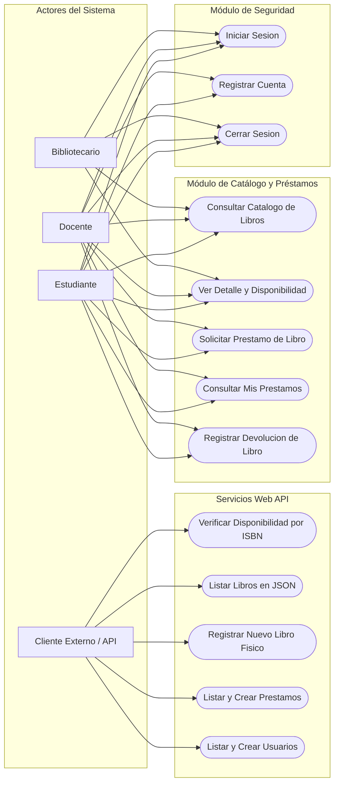
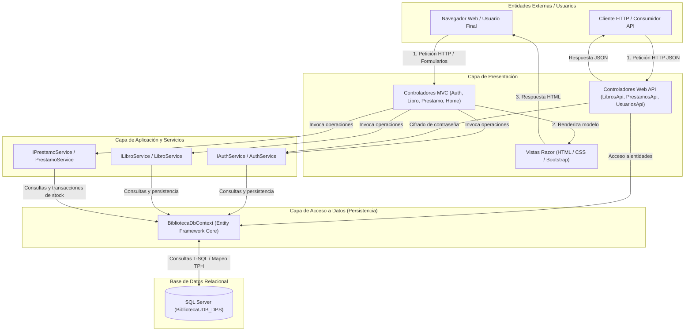

# Sistema de Gestión de Biblioteca — BibliotecaApp

Proyecto de Cátedra · Universidad Don Bosco (UDB)  
Asignatura: Desarrollo de Programas Sección 01  
Ciclo: CF1

---

## Integrantes del Equipo

| # | Apellidos | Nombres | Carné |
|---|---|---|---|
| 1 | Ruiz Hernández | Edgar Antonio | RH201851 |
| 2 | Henriquez Vasquez | Axel Francisco | HV230423 |
| 3 | Varela Linares | Marjorie Daniela | VL261354 |
| 4 | Ramirez Torres | Eduardo Alfredo | RT240549 |
| 5 | Azucena Ayala | Carlos Josue | AA260854 |
| 6 | Ayala Palacios | Marcos Ezequiel | AP260351 |

---

## Descripción General

**BibliotecaApp** es una solución web empresarial desarrollada bajo la plataforma **ASP.NET Core (.NET 10.0)** utilizando una arquitectura por capas combinada con el patrón **Model-View-Controller (MVC)** y servicios **RESTful Web API**.

El sistema gestiona el catálogo bibliográfico universitario, el control de inventario de ejemplares físicos, la administración de préstamos y devoluciones, y la seguridad mediante autenticación con cookies institucionales y cifrado criptográfico robusto.

---

## Módulos del Sistema

### 1. Módulo de Seguridad y Autenticación
* **Inicio de Sesión (Login):** Interfaz institucional con validación de credenciales UDB (`@udb.edu.sv`), recordatorio de sesión persistente (7 días) y alternador interactivo de visibilidad de contraseña.
* **Registro de Usuarios (Register):** Registro asistido con validación de contraseñas de al menos 8 caracteres y asignación de perfiles (`Estudiante`, `Docente`, `Bibliotecario`).
* **Criptografía:** Hash de contraseñas mediante **PBKDF2 (SHA-256)** con sal criptográfica aleatoria de 128 bits y 100,000 iteraciones para mitigación de ataques por diccionario y tablas rainbow.
* **Gestión de Sesión:** Autenticación basada en Cookies HTTP seguras (`CookieAuthenticationDefaults`) con expiración deslizante (`SlidingExpiration`).

### 2. Módulo de Catálogo y Préstamos
* **Catálogo de Libros:** Visualización interactiva en cuadrícula con badges de estado dinámicos (`Disponible`, `Agotado`).
* **Ficha de Detalle:** Consulta técnica del ejemplar (ISBN, autor, género, año, estantería asignada y existencias disponibles).
* **Gestión Transaccional de Préstamos:** Deducción automática del stock en base de datos al confirmar el préstamo.
* **Control de Devoluciones ("Mis Préstamos"):** Panel de usuario para seguimiento de fechas límite y restitución de existencias al inventario.
* **Reglas de Integridad:** Bloqueo de préstamos duplicados del mismo ejemplar por usuario y validación de disponibilidad previa a la reserva.

### 3. Módulo Web API RESTful
* Endpoints para interoperabilidad, consultas externas y futuras integraciones cliente/móvil con salida en formato JSON estandarizado.

---

## Tecnologías Utilizadas

| Componente | Tecnología | Versión | Propósito |
|---|---|---|---|
| Lenguaje | C# | 13 | Lógica de negocio y backend |
| Plataforma | .NET SDK | 10.0 (`net10.0`) | Entorno de ejecución |
| Framework Web | ASP.NET Core | 10.0 | MVC y controladores Web API |
| ORM | Entity Framework Core | 10.0.12 | Mapeo relacional (TPH) y persistencia |
| Base de Datos | Microsoft SQL Server | 2019+ / LocalDB | Motor relacional de almacenamiento |
| Frontend | Razor Views + Bootstrap 5 | 5.3.0 | Estructura responsiva y componentes UI |
| Iconografía | Bootstrap Icons | 1.10.5 | Iconos vectoriales de interfaz |
| Seguridad | PBKDF2 / SHA-256 | Criptografía nativa | Almacenamiento seguro de credenciales |

---

## Diagramas del Sistema

### Diagrama de Casos de Uso

El siguiente diagrama detalla los casos de uso principales clasificados por los roles de usuario y clientes externos:



---

### Diagrama de Flujo de Datos (DFD Nivel 1)

El siguiente diagrama ilustra cómo fluyen los datos entre las capas de presentación (Vistas y API), lógica de negocio, acceso a datos y base de datos SQL Server:



---

## Requisitos Previos

Antes de ejecutar la aplicación, asegúrate de contar con las siguientes herramientas instaladas en tu equipo:

1. **.NET 10.0 SDK**: [Descargar .NET SDK](https://dotnet.microsoft.com/download)
   * Verificar en terminal con: `dotnet --version`
2. **Microsoft SQL Server**: SQL Server Developer, Express o LocalDB.
3. **Herramienta de Base de Datos (Opcional)**: SQL Server Management Studio (SSMS) o Azure Data Studio.
4. **Herramienta CLI de Entity Framework Core (Opcional para migraciones manuales)**:
   ```bash
   dotnet tool install --global dotnet-ef
   ```

---

## Configuración del Entorno

### 1. Clonar el Repositorio

Abre una terminal y clona el proyecto en tu directorio de trabajo:
```bash
git clone https://github.com/EduardoRamirez86/BibliotecaApp_CF1_DPS.git
cd BibliotecaApp_CF1_DPS
```

### 2. Configurar la Cadena de Conexión

Abre el archivo `appsettings.json` ubicado en la raíz del proyecto y ajusta la cadena de conexión según tu instancia de SQL Server:

#### Para SQL Server Local (Instancia por defecto):
```json
{
  "ConnectionStrings": {
    "ConexionSQL": "Server=localhost;Database=BibliotecaUDB_DPS;Trusted_Connection=True;TrustServerCertificate=True;"
  }
}
```

#### Para SQL Server Express:
```json
{
  "ConnectionStrings": {
    "ConexionSQL": "Server=.\\SQLEXPRESS;Database=BibliotecaUDB_DPS;Trusted_Connection=True;TrustServerCertificate=True;"
  }
}
```

#### Para LocalDB (Visual Studio):
```json
{
  "ConnectionStrings": {
    "ConexionSQL": "Server=(localdb)\\mssqllocaldb;Database=BibliotecaUDB_DPS;Trusted_Connection=True;TrustServerCertificate=True;"
  }
}
```

---

## Inicialización de Base de Datos y Semillero (Data Seeding)

El sistema cuenta con un inicializador automatizado en `Program.cs` mediante la clase `DbSeeder.cs`. Al ejecutar la aplicación por primera vez:

1. Ejecuta automáticamente `context.Database.MigrateAsync()`, creando la base de datos `BibliotecaUDB_DPS` y sus tablas asociadas.
2. Si la tabla `Usuarios` está vacía, inserta automáticamente los registros iniciales y el inventario base de libros.

### Migración Manual Alternativa (Opcional)
Si prefieres crear el esquema previamente desde la consola:
```bash
dotnet ef database update
```

---

## Ejecución del Proyecto

### Opción A: Mediante Línea de Comandos (.NET CLI)

1. Restaura las dependencias y compila:
   ```bash
   dotnet build
   ```
2. Ejecuta la aplicación:
   ```bash
   dotnet run
   ```
3. La consola mostrará las URLs de escucha, usualmente:
   * **HTTPS:** `https://localhost:7049`
   * **HTTP:** `http://localhost:5049`
4. Al ingresar en el navegador, el sistema te redirigirá automáticamente a la pantalla de autenticación:
   ```
   https://localhost:7049/Auth/Login
   ```

### Opción B: Mediante Visual Studio 2022

1. Abre la solución `BibliotecaApp.slnx` o el archivo de proyecto `BibliotecaApp.csproj`.
2. Verifica que el perfil de inicio esté seleccionado en `BibliotecaApp` o `https`.
3. Presiona **F5** (con depurador) o **Ctrl + F5** (sin depurador).
4. El navegador predeterminado se abrirá automáticamente en la pantalla de inicio de sesión.

---

## Cuentas de Prueba Preconfiguradas (Semilla)

El sistema incluye las siguientes credenciales preconfiguradas para pruebas inmediatas:

| Rol | Correo Electrónico | Contraseña | Descripción |
|---|---|---|---|
| **Bibliotecario** | `biblioteca@udb.edu.sv` | `Admin1234!` | Acceso administrativo |
| **Docente** | `roberto.mejia@udb.edu.sv` | `Docente1234!` | Perfil académico para solicitud de préstamos |
| **Estudiante** | `carlos.martinez@udb.edu.sv` | `Estudiante1234!git checkout maingit checkout main` | Perfil de alumno con carné universitario |

> **Nota:** Puedes registrar usuarios adicionales directamente desde la interfaz web en la opción *"¿No tienes cuenta? Regístrate aquí"*.

---

## Catálogo de Endpoints de la Web API

La aplicación expone servicios REST bajo el prefijo `/api/`:

### Libros (`/api/LibrosApi`)
| Método | Ruta | Descripción | Cuerpo de Petición (Body) |
|---|---|---|---|
| `GET` | `/api/LibrosApi` | Obtiene el catálogo completo de libros en formato JSON | Ninguno |
| `GET` | `/api/LibrosApi/{isbn}/disponibilidad` | Consulta si un libro tiene stock disponible según su ISBN | Ninguno |
| `POST` | `/api/LibrosApi` | Registra un nuevo libro físico en el catálogo | Objeto JSON `LibroFisico` |

### Préstamos (`/api/PrestamosApi`)
| Método | Ruta | Descripción | Cuerpo de Petición (Body) |
|---|---|---|---|
| `GET` | `/api/PrestamosApi` | Lista todos los préstamos registrados con datos seguros | Ninguno |
| `POST` | `/api/PrestamosApi` | Registra un nuevo préstamo para un usuario y libro | Objeto JSON `CrearPrestamoDto` |

### Usuarios (`/api/UsuariosApi`)
| Método | Ruta | Descripción | Cuerpo de Petición (Body) |
|---|---|---|---|
| `GET` | `/api/UsuariosApi` | Lista todos los usuarios registrados sin exponer contraseñas | Ninguno |
| `POST` | `/api/UsuariosApi` | Registra un nuevo usuario en la base de datos | Objeto JSON `RegisterDto` |

---

## Estructura de Carpetas del Proyecto

```plaintext
BibliotecaApp_CF1_DPS/
├── Controllers/         # Controladores MVC y Controladores Web API
│   ├── AuthController.cs
│   ├── HomeController.cs
│   ├── LibroController.cs
│   ├── LibrosApiController.cs
│   ├── PrestamoController.cs
│   ├── PrestamosApiController.cs
│   └── UsuariosApiController.cs
├── Data/                # Contexto Entity Framework Core y Seeder
│   ├── BibliotecaDbContext.cs
│   └── DbSeeder.cs
├── DTOs/                # Data Transfer Objects para Auth y Préstamos
│   ├── Auth/
│   └── Prestamos/
├── Enums/               # Enumeraciones de dominio (RolUsuario, etc.)
├── Interfaces/          # Contratos de servicios (SOLID - Inversión de Dependencias)
├── Migrations/          # Migraciones versionadas de base de datos
├── Models/              # Entidades del Dominio (Usuario, Libro, Prestamo)
├── Properties/          # Configuración de perfiles de lanzamiento (launchSettings.json)
├── Services/            # Implementación de la lógica de negocio y seguridad
├── Views/               # Vistas Razor para la interfaz de usuario
│   ├── Auth/
│   ├── Home/
│   ├── Libro/
│   ├── Prestamo/
│   └── Shared/
├── wwwroot/             # Archivos estáticos (CSS, JS, librerías)
├── appsettings.json     # Configuración y cadena de conexión a SQL Server
├── architecture.md      # Documentación interna de arquitectura
├── BibliotecaApp.csproj # Archivo de proyecto .NET 10
└── README.md            # Documentación principal del repositorio
```
